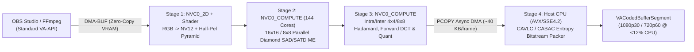
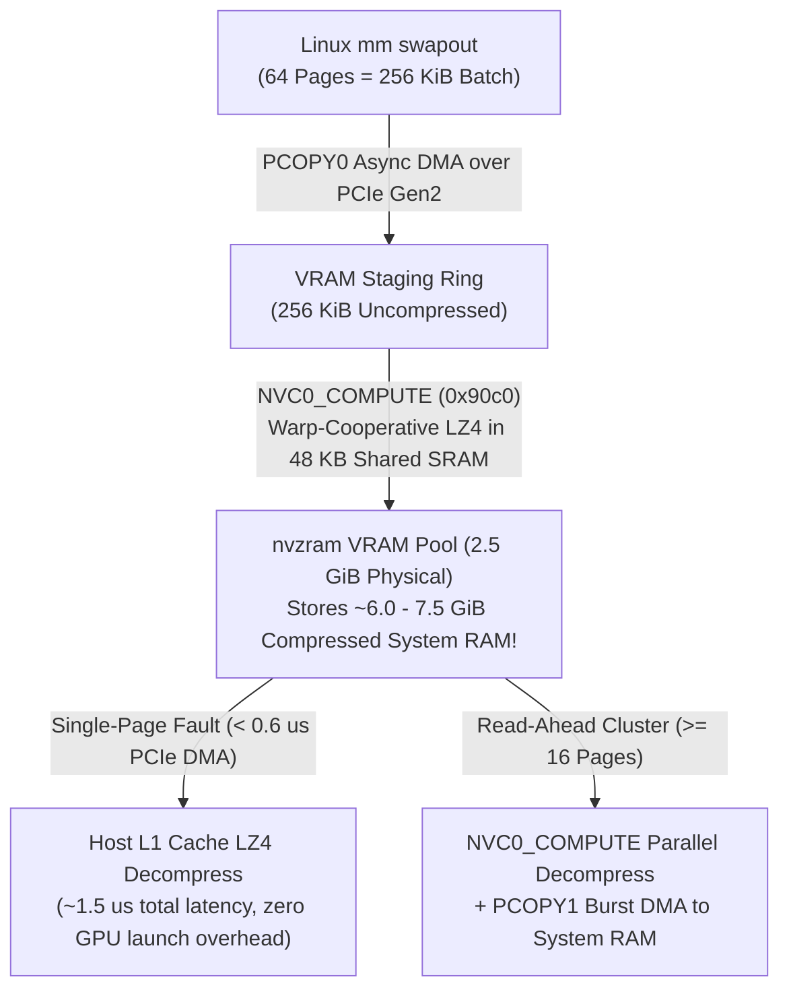

A month ago, I published my [first technical deep dive](/news/nouveau-fermi-reclock-deep-dive/) into `nouveau-fermi-reclock-dkms`, explaining how I brought core, shader, and voltage scaling to NVIDIA Fermi GPUs (`NVC0`/`NVC1`/`NVC3`/`NVC4`/`NVC8`/`NVCE`/`NVCF`) on Linux 6.18. At the end of that article, DDR3 memory reclocking was still the white whale: every attempt to route `MEMX` bytecode through `gt215_pmu_send()` triggered `PRIVRING` bus faults (`0x10a4a0` / `0x10a4cc`), and the 3 GB of DDR3 VRAM on my Dell XPS 17 (`L702X`, GeForce GT 555M `GF106M`) remained pinned at its boot clock of `324 MHz`.

Since then, two major things happened:

1. **I shipped `v2.0.0` and `v2.1.0`**: Full bidirectional DDR3 memory reclocking (`324 MHz` ↔ `900 MHz`), S3 suspend/resume self-healing recovery (`0xE1EC0001`), dynamic PCIe Gen1 (`2.5 GT/s`) ↔ Gen2 (`5.0 GT/s`) link scaling, and a verified **P-State `10` Overclock** (`700 MHz` core / `1400 MHz` shader / `900 MHz` DDR3 @ `1.030 V`, reaching **403.2 GFLOPS** and **28.8 GB/s** memory bandwidth) are now live in production.
2. **I decompiled the proprietary NVIDIA `390.157` legacy binary driver (`nv-kernel.o_binary` and `nv-modeset-kernel.o_binary`) using Ghidra and Reverse Engineer Anything (`REA`)**: Instead of relying solely on blind `mmiotrace` black-box captures, I traced the exact Resource Manager (`RM`) and Kernel Modesetting (`KMS`) functions inside NVIDIA's final Fermi driver release.

What I found inside `390.157` did not just answer every lingering hardware mystery about Fermi clock transitions, VBlank display synchronization, and 120 Hz 3D Vision eDP panels—it opened the door to transforming this repository into **[`nouveau-reclocking-dkms`](https://github.com/Twilight0/nouveau-fermi-reclock-dkms)**: a comprehensive, actively maintained out-of-tree driver and compute stack for **all pre-`Nova` NVIDIA architectures** (Tesla through Pascal).

Here is the complete breakdown of what I shipped, what I uncovered inside NVIDIA's stripped object files, and the engineering roadmap ahead.

---

## Part 1: What Shipped in `v2.0.0` & `v2.1.0` — Breaking the 324 MHz DDR3 Wall

On Fermi, `gt215_pmu_send()` fails because the `PDAEMON` Falcon microcontroller (`0x10a000`) reorganized its command queues (`0x10a1c0+`) and privilege masks compared to Tesla (`GT215`), and Nouveau's open-source `gf100.fuc3` firmware only implements two minimal host process IDs (`0x00000001` I2C and `0x00000002` Ghost/Context). It has no `MEMX` bytecode interpreter at all.

Wait—if the Falcon doesn't execute memory reclocking on Fermi under Nouveau, can the host CPU execute the entire 62-step DDR3 PHY/DLL/PLL transition directly over `BAR0` MMIO?

**Yes.** In `v2.0.0`, I bypassed the dead PMU `MEMX` path in `gf100_ram_prog()` and implemented a direct host-CPU MMIO sequencer in `nvkm/subdev/fb/ramgf100.c` backed by exact `mmiotrace` register profiles captured from NVIDIA `390.157` on my `GF106M` (`10de:0dcd`):

```text
[   12.841209] nouveau 0000:01:00.0: fb: direct DDR3 reclocking: 324000 -> 900000 kHz
[   12.841488] nouveau 0000:01:00.0: fb: direct DDR3 reclock complete (MPLL=0x80034b04, 900000 kHz)
```

### The `v2.1.0` Performance Ladder on GeForce GT 555M (`GF106M`)

In `v2.1.0`, I extended the hardware state table with a custom **P-State `10` Overclock** (`700 MHz` core / `1400 MHz` shader / `900 MHz` DDR3 @ `1.030 V`) and added PCIe link speed switching via `0x08c040`:

| P-State | Core (`gpc2clk`) | Shader (`sys2clk`) | Memory (`mclk`) | Bandwidth | Voltage | PCIe Link | Compute (`FP32`) |
| :--- | :---: | :---: | :---: | :---: | :---: | :---: | :---: |
| **`03` (Idle)** | `50 MHz` | `101 MHz` | `135 MHz` | `4.3 GB/s` | `0.830 V` | Gen1 (`2.5 GT/s`) | `29.1 GFLOPS` |
| **`07` (Med)** | `202 MHz` | `405 MHz` | `324 MHz` | `10.4 GB/s` | `0.850 V` | Gen1 (`2.5 GT/s`) | `116.6 GFLOPS` |
| **`0f` (Boost)** | `590 MHz` | `1180 MHz` | `900 MHz` | `28.8 GB/s` | `0.980 V` | Gen2 (`5.0 GT/s`) | `339.8 GFLOPS` |
| **`10` (OC)** | **`700 MHz`** | **`1400 MHz`** | **`900 MHz`** | **`28.8 GB/s`** | **`1.030 V`** | **Gen2 (`5.0 GT/s`)** | **`403.2 GFLOPS`** |

I also solved a nasty S3 suspend/resume corner case: when the laptop wakes from sleep while `nouveau-dynclockd` or the user had left the GPU in P-state `0f` or `10`, VBIOS POST resets the PLLs to boot clocks while Nouveau's software state machine believes it is still at `0f`. I added the `0xE1EC0001` self-healing resume marker in `nvkm_clk_init()`, which forces a clean hardware re-application of the active P-state and restores the user's pre-suspend state across sleep cycles.

---

## Part 2: Dissecting `NVIDIA-Linux-x86_64-390.157` with Ghidra & REA

While my `mmiotrace`-driven `v2.1.0` implementation worked reliably at `135`, `324`, and `900 MHz`, several deep questions remained:
1. Why did my `mmiotrace` logs show the proprietary driver interacting with the `PDAEMON` Falcon during memory transitions if the Falcon wasn't executing `MEMX`?
2. What was the undocumented `OBJSEQ` opcode `0x3a` right before the `FB_RESUME` step, and why was it polling `0x13d7f4`?
3. How does NVIDIA prevent screen flicker on high-bandwidth panels during a memory clock switch?
4. Can I synthesize an intermediate **P3 (`405 MHz` core / `810 MHz` shader / `650 MHz` DDR3)** state that not even NVIDIA's VBIOS exposed on the `L702X`?
5. Why does the `L702X`'s `1920x1080 @ 120 Hz` 3D Vision eDP panel (`LGD 0x02c5`, `396.36 MHz` pixel clock) work effortlessly on `390.157` while failing link bandwidth checks on standard KMS drivers?

To get definitive answers, I unpacked `NVIDIA-Linux-x86_64-390.157.run` and loaded both stripped kernel blobs—`nv-kernel.o_binary` (`15.6 MB`, 22,571 functions) and `nv-modeset-kernel.o_binary` (`1.4 MB`, 2,520 functions)—into **REA (Reverse Engineer Anything)** backed by headless Ghidra.

### 1. The Fermi `PDAEMON` Handshake (`_nv029783rm` & `_nv029647rm`)
Even though the `OBJSEQ` VM executes on the host CPU inside `nv-kernel.o_binary`, the host CPU **cannot** blindly freeze the memory controller (`STOP_FB`) while the `PDAEMON` Falcon (`0x10a000`) is actively accessing `BAR0` or running background context tasks.
Decompiling `_nv029783rm` and `_nv029647rm` revealed the exact hardware mutex handshake between the host CPU and the Falcon microcontroller:
- The host reads `0x10a128` (`PPWR_FALCON_CTX_STATE`) and checks `(val & 0xF) == 2 || (val & 0xF) == 5`.
- To pause the Falcon's memory interface before `STOP_FB`, `_nv029647rm` writes `1` to `0x10a058` (`PPWR_FALCON_CTX_ACK`) and spins on `0x10a128` until `(val & 0xF)` transitions out of active states `2`/`5`.
- Once the `MPLL` locks at the new frequency, the host writes `2` to `0x10a058` to release the Falcon context lock.

### 2. Decoding the `OBJSEQ` Bytecode VM & Solving Mystery Opcode `0x3a` (`_nv031754rm`)
In `nv-kernel.o_binary`, memory reclocking is built by `_nv021480rm` into a bytecode stream for the internal `OBJSEQ` sequencer (`_nv031862rm` interpreter loop). By tracing the jump table, I recovered the complete opcode specification (`0x01..0x43`) and tracked down opcode **`0x3a`**:

```c
// Decompiled from _nv031754rm (GF100 FB Partition Write-Buffer Flush)
void _nv031754rm(POBJGPU pGpu, POBJFB pFb) {
    for (u32 part = 0; part < pFb->numPartitions; part++) {
        u32 reg = 0x13c000 + (part * 0x800) + 0x7f4; // 0x13c7f4, 0x13cf74, 0x13d7f4...
        u32 val = GPU_REG_RD32(pGpu, reg);
        GPU_REG_WR32(pGpu, reg, (val & ~0x30100) | 0x20100);
        while ((GPU_REG_RD32(pGpu, reg) & 0x30000) != 0) {
            osDelayNs(100); // Wait for partition write buffer drain
        }
    }
}
```

Mystery solved! Address `0x13d7f4` in my `GF106M` `mmiotrace` was partition `i = 3` (`0x13c000 + 3 * 0x800 + 0x7f4`) of the per-partition L2/DRAM write-buffer flush loop. Without draining every active memory partition before releasing `STOP_FB`, in-flight cache lines can corrupt adjacent scanout surfaces.

### 3. Zero-Flash VBlank & `ISOHUB` Display Synchronization (`_nv031916rm` / `_nv031860rm`)
Why does memory reclocking cause a brief visual glitch if executed at an arbitrary moment? Because the `NVDisplay`/`evo` scanout engine starves for pixels while DRAM is in Self-Refresh (`0x10f200`).
Inside `_nv031916rm`, `_nv031860rm`, and `_nv031861rm`, I found how NVIDIA achieves **zero-flash** transitions:
1. **Pre-Stop `ISOHUB` Critical Watermark Spool-Up (`_nv031860rm`)**: Before stopping FB, RM updates `0x610050 + head*0x540` (`PDISP_ISOHUB`) to force the display line buffer into **Critical High-Priority Fetch** mode so it spools a full scanline into SRAM before the memory bus goes dark.
2. **In-Sequencer `WAIT_VBLANK` (Opcode `0x14`, `_nv031916rm`)**: Rather than waiting for VBlank in kernel thread context *before* building the script (which leaves `50–200 µs` of scheduling jitter), the `WAIT_VBLANK` poll is placed *immediately* before `STOP_FB` (Opcode `0x18`), spinning on the active CRTC's `0x616340` (`RG_STATUS`) bit 0 rising edge so the entire `~110 µs` PLL/DLL sequence completes inside the vertical blanking interval!

### 4. Unlocking Synthetic P3 (`0a`): `405 MHz` Core / `810 MHz` Shader / `650 MHz` DDR3 @ `0.920 V`
On the `L702X`, the VBIOS jumps straight from P-state `07` (`202/405/324 MHz`) to P-state `0f` (`590/1180/900 MHz`). There is no intermediate state for medium workloads (like 1080p60 video playback, desktop compositing, or light gaming).

Could I synthesize a hardware-accurate **P3 (`0a`)** state at `405/810/650 MHz`? I needed two things from `390.157`: the exact `0x132004` (`MEMPLL_COEFF`) bitfield formula, and the DDR3 Mode Register (`MR0`–`MR2`) and timing threshold calculators.
- **`_nv010738rm` (`MEMPLL_COEFF` Solver)**: Revealed the exact bit layout: `bits [7:0] = M` (`0x02`), `bits [15:8] = N`, `bits [21:16] = P` (`0x01`), `bit 28 = EN_SDM`. From my `27.0 MHz` crystal (`324 MHz / 12`), `N = 0x27` (`39`) yields **`0x132004 = 0x10012702`**, locking the DDR3 bus at **`650 MHz`** (`20.8 GB/s` bandwidth)!
- **`_nv014883rm` & `_nv014880rm` (DDR3 Timing & PHY Thresholds)**: Showed that `390.157` uses two discrete frequency thresholds at `405,000 kHz` and `500,000 kHz` for `0x10f290..0x10f2a0` and `0x10f808..0x10f824`. Because `650 MHz > 500 MHz`, it shares the high-speed JEDEC CL9/CWL7 mode register profile with interpolated refresh (`tREFI`) and drive calibration, paired with **`0.920 V` (`VID 0x03`)**.

### 5. Cracking the 120 Hz 3D Vision eDP Mystery (`_nv000659kms`, `_nv002219kms`, `_nv002187kms`)
The Dell XPS `L702X` 3D Vision edition uses an internal eDP panel (`LGD 0x02c5`) with a `1920x1080 @ 119.97 Hz` timing mode requiring a **`396.36 MHz` pixel clock**.
Here is the math puzzle: a 4-lane HBR1 (`2.7 Gbps/lane`) eDP link has a maximum raw data capacity (after 8b/10b encoding) of **`8.64 Gbps`**. At standard `8 bpc` (`24 bpp` RGB), `396.36 MHz * 24 bits = 9.51 Gbps`, which **exceeds** the physical capacity of a 4-lane HBR1 link (`9.51 Gbps > 8.64 Gbps`)!

How did `390.157` light up this panel at 120 Hz? Decompiling `nv-modeset-kernel.o_binary` revealed three mechanisms working together:
1. **EDID Pixel Clock Tolerance (`_nv000659kms`)**: Standard EDID Base blocks store max pixel clock in `10 MHz` steps (`0x27 * 10 = 390 MHz`), which is `6.36 MHz` shy of `396.36 MHz`. `_nv000659kms` adds a **`+5.0 MHz` (`+5000 kHz`) grace margin** to the EDID range descriptor and bypasses the cap entirely for stereo-capable / internal eDP native DTDs.
2. **Automatic DP Color Depth Step-Down (`8 bpc` → `6 bpc`, `_nv002219kms`)**: When `_nv002219kms` evaluates DisplayPort link configuration and sees `396.36 MHz * 24 bpp > 8.64 Gbps`, it automatically steps `color_depth` down from `8 bpc` (`24 bpp`) to **`6 bpc` (`18 bpp`) with spatial/temporal dithering enabled** (`396.36 MHz * 18 bpp = 7.13 Gbps <= 8.64 Gbps`)!
3. **Isochronous Mode Possible (IMP) P-State Floor (`_nv002187kms`)**: At `396.36 MHz` (`~1.19 GB/s` uncompressed scanout read), P-state `03` (`135 MHz` DDR3) will immediately underflow. Both the kernel DRM driver and `nouveau-dynclockd` 2.0 will enforce P-state `07` (`324 MHz`) as the minimum floor whenever a mode with `clock > 300,000 kHz` is active, alongside native support for the built-in **NVIDIA 3D Vision USB IR Emitter (`0955:0007`)** and KMS `STEREO_3D` page-flipping.

---

## Part 3: Pushing Fermi Beyond 2018 — Vulkan, Hybrid VA-API Encoding, OpenCL 3.0 & `nvzram`

NVIDIA froze Fermi support in `390.157` in early 2018. That means Fermi never received Vulkan, never received OpenCL 3.0, and—on the 3D Vision `L702X` where the Intel Sandy Bridge QuickSync iGPU is hardwired off in BIOS so the `GF106M` can drive the 120 Hz eDP panel directly—there is **no hardware video encoder** (`NVENC` was only introduced on Kepler `GK104`) for OBS Studio or FFmpeg.

Because I control both the kernel DRM/NVKM layer and the userspace Mesa integration, I am not bound by NVIDIA's 2018 product segmentation. I have authored two dedicated architecture specifications in the repository—[`VULKAN.md`](https://github.com/Twilight0/nouveau-fermi-reclock-dkms/blob/master/VULKAN.md) and [`VRAM_AI.md`](https://github.com/Twilight0/nouveau-fermi-reclock-dkms/blob/master/VRAM_AI.md)—alongside Section 8 of [`TODO.md`](https://github.com/Twilight0/nouveau-fermi-reclock-dkms/blob/master/TODO.md).

### 1. Hybrid Compute-Shader + Host `VA-API` H.264 Encoder for OBS Studio
Before Kepler introduced the fixed-function `NVENC` ASIC, NVIDIA shipped **`NVCUVENC`** on Fermi GPUs—a hybrid hardware/shader H.264 encoder that ran color conversion, motion estimation, and DCT/Quantization on the Fermi streaming multiprocessors (`SM20`/`SM21`) while performing final CABAC/CAVLC bitstream packing on the CPU.

I am designing a standard **Mesa Gallium `VA-API` (`VAEntrypointEncSlice` / `VAProfileH264ConstrainedBaseline`, `Main`, `High`)** frontend so OBS Studio (`obs-vaapi`), FFmpeg (`-c:v h264_vaapi`), and GStreamer (`vaapih264enc`) work out of the box on Fermi without custom app patches:



With the `GF106M` reclocked to P-state `0f`/`10` (`339.8–403.2 GFLOPS`), offloading Stages 1–3 to the GPU leaves `< 12%` host CPU utilization on the quad-core Sandy Bridge i7 for `1080p30` or `720p60` real-time streaming.

### 2. Vulkan 1.0 / 1.1 on Fermi (`nvk-fermi` Bound Descriptor Lowering)
Why did Mesa's `NVK` Vulkan driver target Kepler (`GK104+`) as its minimum floor? Only one major architectural boundary separates Fermi (`NVC0_3D` `0x9097` / `NVC0_COMPUTE` `0x90c0`) from Kepler (`NVE4_3D` `0xa097`):
- **Kepler+** supports *bindless texture handles*, reading arbitrary 32-bit `TIC`/`TSC` indices directly from a uniform buffer in the `TEX` instruction.
- **Fermi** uses a **Bound `TIC`/`TSC` Binding Table** (128 Texture Image Control slots + 32 Texture Sampler Control slots per shader stage), while already possessing all other hardware primitives required for Vulkan 1.0/1.1 (Full 40-bit Virtual Memory, `NVC0_COMPUTE` `0x90c0` with 64 KB L1/Shared memory, Indirect Draw/Dispatch, 8 MRTs, Geometry & Tessellation shaders, and Mesa's rock-solid `NIR -> nv50_ir -> NVC0` compiler backend).

Just as Intel split `ANV` to create **`hasvk`** for Ivy Bridge / Haswell GPUs with finite binding tables, my [`VULKAN.md`](https://github.com/Twilight0/nouveau-fermi-reclock-dkms/blob/master/VULKAN.md) blueprint pairs `NVK`'s command buffer/sync core with bound descriptor lowering into Fermi's 128 `TIC` / 32 `TSC` slots and routes `SPIR-V -> NIR -> nv50_ir`.

### 3. OpenCL 3.0 (`Mesa Rusticl`), Unified `VRAM + GART` LLM Inference, and GPU-Compressed `nvzram`
With the `GF106M` running at `28.8 GB/s` and `403.2 GFLOPS`, its 3 GB of dedicated DDR3 VRAM is a surprisingly capable local accelerator—if the software stack gets out of the way:
- **OpenCL 3.0 via Mesa `Rusticl`**: Exposing `NVC0_COMPUTE` (`0x90c0`) through `Rusticl` (`RUSTICL_ENABLE=nouveau`) and raising the conservative `max_mem_alloc_size` cap from 25% of VRAM (`768 MiB`) to **85–90% of VRAM (`~2.75 GiB`)** so `llama.cpp` and `ggml` can allocate contiguous model weight buffers.
- **Unified `VRAM + GART` (`TTM_PL_VRAM | TTM_PL_TT`) Model Pooling**: Allowing `> 3 GiB` quantized LLMs (e.g., 7B/8B `Q4_K_M` at `4.3 GiB`) to seamlessly span `2.7 GiB` of fast on-board VRAM and `1.6 GiB` of PCIe Gen2 system RAM, using Fermi's hardware `PCOPY0`/`PCOPY1` (`0x90b5` / `0x90b8`) DMA engines to asynchronously prefetch the next transformer layer while the shaders compute the current layer.
- **`nvzram` — GPU-Accelerated Compressed Swap in VRAM**: Standard Linux `zram` compresses pages on the CPU and stores them in system RAM. What if I reserve the upper `2.5 GiB` of the GPU's `3.0 GiB` VRAM and let **Fermi's 144 shader cores (`NVC0_COMPUTE`) perform batched Warp-LZ4 compression inside VRAM**?



Notice the asymmetric `swapin` optimization documented in [`VRAM_AI.md`](https://github.com/Twilight0/nouveau-fermi-reclock-dkms/blob/master/VRAM_AI.md):
- **On `swapout`**, pages are batched (`64–256 pages`) and compressed asynchronously on the GPU (`~1.2–1.8 GB/s` throughput at **0% host CPU cost**), turning `2.5 GiB` of idle VRAM into **`6.0–7.5 GiB` of compressed system RAM**.
- **On single-page `swapin`**, waking up a compute channel for a single `4 KiB` page would add `~5–8 µs` of launch latency. Instead, `PCOPY1` DMAs only the **compressed** `~1.6 KiB` slice over PCIe (`0.5 µs`, saving 60% bus time!) and the host CPU decompresses it in L1 cache in `~1.0 µs`. For multi-page cluster read-aheads (`>= 16 pages`), `NVC0_COMPUTE` decompresses all pages in parallel inside VRAM!

---

## Part 4: Why I Am Evolving This into `nouveau-reclocking-dkms` for All Pre-`Nova` GPUs

A question I recently asked myself is: *Why not submit all of this upstream to mainline `nouveau`?*

The realistic answer comes down to where upstream Linux kernel graphics development is in 2026:
1. **Upstream `nouveau` is effectively in maintenance freeze for pre-Turing (`NV50`–`NV130`) hardware**, while Red Hat and NVIDIA engineers focus on **`Nova`** (the new Rust kernel driver exclusively for Turing `NV160+` GPUs with a GSP processor) and **`NVK`** (targeting Kepler+ for Vulkan).
2. **Mainline kernel policies strictly reject board-specific / architecture-tuned direct MMIO sequencers, custom overclocking P-states (`10`), and out-of-band VBIOS overrides** unless proven across every retail OEM board variant ever manufactured.

Rather than letting a decade of perfectly capable NVIDIA silicon rot at boot clocks while waiting on upstream policies that no longer prioritize pre-GSP hardware, **I am maintaining `nouveau-reclocking-dkms` as a first-class, continuously rebased out-of-tree DKMS driver stack** with automated CI builds across LTS, stable, and mainline RC kernels (`6.12 LTS`, `6.18`, `6.19+`), plus native packaging pipelines for **Arch Linux (`PKGBUILD`), Debian/Ubuntu (`.deb`), Fedora/RHEL/openSUSE (`.rpm`), Gentoo (`ebuild`), and NixOS (`flake.nix`)**.

And because my decompilation of `NVIDIA-Linux-x86_64-390.157` exposes the exact `OBJCLK`, `OBJFB`, `OBJSEQ`, `OBJPMU`, and `OBJVOLT` routines across **four generations of NVIDIA architectures**, my roadmap expands beyond Fermi to cover the entire **Pre-`Nova` hardware gap**:

| Generation | Chip Families | Upstream Nouveau Bottleneck | `nouveau-reclocking-dkms` Target |
| :--- | :--- | :--- | :--- |
| **Tesla (`NV50`–`NVA8`)** | GeForce 8000/9000/200/300 | Experimental/broken DDR2/DDR3/GDDR3 reclocking; no dynamic daemon | Stabilized `nv50`/`gt215` RAM/PLL tables + `nouveau-dynclockd` |
| **Fermi (`NVC0`–`NVCF`)** | GeForce 400/500/600M–800M | **0% memory reclocking upstream**; broken `MEMX`; no 120 Hz 3D Vision BPC step-down | **Complete (`v2.1.0`)** + Zero-Flash VBlank, P3 (`650 MHz`), 120 Hz `6 bpc`, Hybrid VA-API, `nvzram` |
| **Kepler (`NVE0`–`NV108`)** | GeForce 600/700/800M | Manual `pstate` only; GDDR5 training bugs; missing `MSENC` VA-API glue | Auto-governed reclocking + `390.157` GDDR5 PHY fixes + `MSENC` (`0x1c8000`) H.264 encode |
| **Maxwell 1 (`NV117`/`NV118`)** | `GM107` / `GM108` (`GTX 750 Ti`, `850M`–`960M`) | **No signed PMU ACR lockdown!** Capable of full reclocking, but unfinished upstream | Full Core + DDR3/GDDR5 reclocking extracted directly from `390.157` (`_nv010xxxrm`) |
| **Maxwell 2 & Pascal (`NV120`–`NV138`)** | GeForce 900 / 10-series | Signed PMU/ACR firmware limits `mclk` on some mobile SKUs; manual P-states | Automated dynamic governor + PCIe scaling + `drm_show_fdinfo` (`nvtop`/`MangoHud`) |

Notice **First-Gen Maxwell (`GM107` / `GM108` — GeForce GTX 750 / 750 Ti, GTX 850M / 860M / 950M / 960M, 940MX)** in particular: unlike Maxwell 2 (`GM20x`) and Pascal (`GP10x`), `GM107` and `GM108` **do not enforce signed PMU/ACR microcontroller lockdown**, yet upstream Nouveau never finished their clock and memory PLL programming! Because `390.157` has full native support for `GM107`/`GM108`, every single clock, voltage, and memory sequencer routine is sitting right inside the same `nv-kernel.o_binary` I just decompiled.

---

## Explore the Code & Documentation

All of my reverse-engineering notes, register tables, decompiled function cross-references, and architectural specifications are open and documented in the repository:

- **Repository**: [github.com/Twilight0/nouveau-fermi-reclock-dkms](https://github.com/Twilight0/nouveau-fermi-reclock-dkms)
- **Hardware & `390.157` Reverse-Engineering Notes**: [`RECLOCKING_NOTES.md`](https://github.com/Twilight0/nouveau-fermi-reclock-dkms/blob/master/RECLOCKING_NOTES.md)
- **Vulkan 1.0/1.1 (`nvk-fermi`) Feasibility & Architecture**: [`VULKAN.md`](https://github.com/Twilight0/nouveau-fermi-reclock-dkms/blob/master/VULKAN.md)
- **OpenCL 3.0 (`Rusticl`), Unified VRAM+GART AI Inference & `nvzram`**: [`VRAM_AI.md`](https://github.com/Twilight0/nouveau-fermi-reclock-dkms/blob/master/VRAM_AI.md)
- **Master Engineering & Pre-`Nova` Roadmap**: [`TODO.md`](https://github.com/Twilight0/nouveau-fermi-reclock-dkms/blob/master/TODO.md)

Legacy hardware only becomes obsolete when we stop understanding how it works. With `390.157` decompiled and the hardware documentation in the open, the real fun is just getting started.
