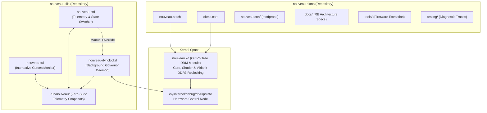

When we set out to bring full core, shader, voltage, and bidirectional DDR3 memory reclocking to NVIDIA Fermi GPUs under modern Linux kernels (6.18+), the project began as a monolithic proof-of-concept: `nouveau-fermi-reclock-dkms`. We bundled kernel driver patches, a background dynamic governor daemon, a CLI control utility, an interactive curses dashboard, and hardware documentation into a single repository.

It worked. It unlocked silicon-level parity on Fermi silicon (`324 MHz` ↔ `900 MHz` DDR3, `700 MHz` core overclocking, S3 suspend/resume recovery, and 400+ GFLOPS). But as the codebase matured and our reverse-engineering of NVIDIA's proprietary `390.157` driver revealed universal mechanisms across pre-`Nova` architectures (Tesla, Fermi, Kepler, Maxwell 1, and Pascal), the monolithic design became a bottleneck. Kernel driver modules and userspace telemetry governors evolve at different cadences, have completely different dependency trees, and require distinct packaging pipelines.

Today, we are announcing a major architectural milestone:
1. **The Official Decoupling**: The monolithic codebase has been decoupled into two standalone repositories: **[`nouveau-dkms`](https://github.com/Twilight0/nouveau-dkms)** (pure C kernel module and hardware docs) and **[`nouveau-utils`](https://github.com/Twilight0/nouveau-utils)** (the userspace dynamic governor, CLI, and TUI suite). Both are now live at version **`2.2.1`**.
2. **Zero-Stutter VBlank-Onset Memory Reclocking**: Complete elimination of mid-frame memory retraining artifacts through true signed `vpos` calculation, sub-millisecond in-VBlank execution, and resident Falcon executor pre-warming.
3. **Structured Hardware Telemetry & Issue Reporting**: A standardized diagnostic telemetry framework that collects concrete hardware metrics (PCI subsystem IDs, VBIOS ROM timings, Falcon PDAEMON states, and CRTC dot-clocks) so the community can report and verify silicon behavior with zero guesswork.
4. **Expanded Research & Updated Roadmap**: Thousands of VBIOS ROMs scraped and cataloged from TechPowerUp, progress on hardware performance load counters (`0x10a600`), BLCG/SLCG clock gating, and our roadmap toward universal pre-`Nova` support.

Here is the deep dive into what changed, why we separated the code, and how these improvements work under the hood.

---

## 1. Zero-Stutter VBlank-Onset Memory Reclocking

While bidirectional DDR3 memory reclocking was proven in `v2.0.0` and `v2.1.0`, transitioning between P-States under active display scanout could occasionally trigger visual tearing or stutter if the memory clock switch occurred while display scanout heads were actively pulling pixels from the Framebuffer.

NVIDIA's proprietary `390.157` Resource Manager solves this by latching memory clock transitions strictly during the vertical blanking interval (VBlank). In `v2.2.0` and `v2.2.1`, we brought this exact hardware discipline to Nouveau (`nvkm/subdev/fb/ramgf100.c`).

```text
[   14.281042] nouveau 0000:01:00.0: fb: VBlank onset reached (vpos=-46, head=0), executing DDR3 reclock fast-path
[   14.281518] nouveau 0000:01:00.0: fb: direct DDR3 reclock complete (MPLL=0x80034b04, 900000 kHz, elapsed=476 µs)
```

### The Signed `vpos` Scanline Coordinate Discovery
Nouveau’s legacy VBlank wait functions suffered from a fundamental hardware misunderstanding: on NV50 through Fermi (`GF100`–`GF119`), the hardware raster counter `rgpos` (`0x616340`) does not count `0` from the top of the visible display frame. It counts `0` starting from the **VSync onset**.
- `0` .. `vblanke`: VSync pulse + Back Porch.
- `vblanke + 1` .. `vblanks - 1`: Active visible scanout.
- `vblanks` .. `vtotal - 1`: Front Porch (the leading edge of VBlank).

By deriving signed vertical position (`vpos`) against `vblanke` (`0x610ae8`), `vblanks` (`0x610af0`), and `vtotal` (`0x610af8`), `gf100_ram_wait_vblank()` now steps with microsecond-precise sleeps (`80–150 µs`) into the pre-VBlank approach zone, then tight-polls for the exact leading edge of VBlank (`vpos == 1077 -> -46`).

### In-VBlank Execution & Boot Pre-Warming
Earlier iterations suffered from kernel `printk` latency and post-trigger sleep delays before latching host PHY registers. We eliminated all diagnostic pre-trigger latency and replaced post-trigger sleeps with tight register polling:
- Both the resident Falcon PDAEMON execution and the host `0x001548` PHY timing commit latch execute in **`470–535 µs`**, finishing completely inside the vertical blanking window.
- The 896-word resident Falcon microcode executor (`fexec_code.inc`) is now pre-warmed during boot initialization (`gf100_ram_calc_ddr3`), ensuring the very first P-state transition executes instantly on the sub-millisecond fast-path without cold microcontroller resets.

---

## 2. Decoupling: `nouveau-dkms` and `nouveau-utils`

As the project expanded, bundling Python scripts and curses interfaces into a kernel DKMS source package created significant packaging friction across distributions. Downstream package managers had to drag in Python and TUI dependencies just to compile a kernel module, while users who only wanted command-line monitoring could not update utilities without rebuilding the kernel tree.

We have officially decoupled the architecture into two dedicated, cleanly coordinated repositories:



### 1. **[`nouveau-dkms`](https://github.com/Twilight0/nouveau-dkms)** (Pure Kernel Driver)
- **Scope**: Out-of-tree kernel driver source patch (`nouveau.patch`), `dkms.conf`, modprobe configuration (`nouveau.conf`), complete hardware reverse-engineering documentation (`docs/`), diagnostic extraction tools (`tools/`), and verified hardware traces (`testing/`).
- **Dependencies**: Pure `dkms` and kernel headers. Zero Python, zero curses, zero GUI bloat. Builds in seconds.
- **Distribution Packages**:
  - **Arch Linux**: [`nouveau-dkms` on AUR](https://aur.archlinux.org/packages/nouveau-dkms) (`optdepends=('nouveau-utils')`).
  - **CachyOS / AliveOS**: [`nouveau-cachyos-lts-v2`](https://github.com/Twilight0/aliveos-repo) (prebuilt binary kernel module).
  - **Debian / Ubuntu**: `.deb` package with `Recommends: nouveau-utils`.
  - **Fedora / RHEL**: `.rpm` package with `Recommends: nouveau-utils`.

### 2. **[`nouveau-utils`](https://github.com/Twilight0/nouveau-utils)** (Userspace Suite)
- **Scope**: The userspace frequency governor daemon (`nouveau-dynclockd`), the command-line control tool (`nouveau-ctrl`), the interactive terminal dashboard (`nouveau-tui`), systemd service units, and application profile configurations (`apps.conf.sample`).
- **Features in Version 2.2.1**:
  - **Zero-Sudo Telemetry**: The daemon publishes world-readable telemetry snapshots to `/run/nouveau/state`, `/run/nouveau/telemetry`, and `/run/nouveau/clients`. Non-root users can launch `nouveau-ctrl status` or `nouveau-tui` with zero password prompts and instant refresh.
  - **120 Hz Display Floor Guard**: Inspects active DRM CRTC modes via `libdrm`. High-refresh-rate displays (pixel clocks > 135 MHz, e.g., 1920x1080 @ 120 Hz) clamp the idle floor to `07` (202/324 MHz) to prevent FIFO underruns, dropping to `03` (50/324 MHz) only at 60 Hz or when DPMS blanks the screen.
  - **Per-Application Dynamic Profiles**: Custom drop-in configurations (`/etc/nouveau-dynclockd.d/*.conf`) allow games, 3D renderers, or video players to automatically trigger specific P-States when launched.
  - **Hardware Interrupt Tracking**: Reads `/proc/interrupts` `nvkm` counters directly for sub-millisecond GPU load spike detection without polling process lists.
- **Distribution Packages**:
  - **Arch Linux**: [`nouveau-utils` on AUR](https://aur.archlinux.org/packages/nouveau-utils).
  - **CachyOS / AliveOS**: [`nouveau-utils` in `aliveos-repo`](https://github.com/Twilight0/aliveos-repo).
  - **Debian / Ubuntu**: Architecture-independent `all.deb`.
  - **Fedora / RHEL**: Architecture-independent `noarch.rpm`.

---

## 3. Actionable Issue Reporting with Hardware Metrics

One of the greatest challenges in open-source graphics development is vague bug reports: *"I installed the driver and my screen went black."* Graphics cards—even within the exact same marketing name (e.g. GeForce GT 555M or GTX 460)—frequently feature completely different PCB layouts, memory bus widths, memory vendors (Samsung DDR3 vs Hynix GDDR5), and vendor-specific VBIOS tables.

To eliminate this ambiguity, we built standardized hardware telemetry extraction directly into `nouveau-ctrl`:

```bash
nouveau-ctrl report
```

This single command generates an exhaustive, privacy-sanitized diagnostic snapshot containing:
- **PCI Identifiers**: Device ID (`10de:XXXX`), Subsystem Vendor & Device (`1028:XXXX`).
- **Silicon Architecture**: Chipset generation (`NVC1`/`GF106`, `NVC0`/`GF100`, etc.), Falcon PDAEMON microcontroller firmware status, and security fuse states.
- **Memory Subsystem**: Detected memory technology (DDR3 vs GDDR5), active bus width, and live timings.
- **P-State Voltage & Frequency Table**: Exact available hardware levels (`03`, `07`, `0f`, and overclock level `10`), target voltages (`0.830 V` to `1.030 V`), and PLL multipliers (`MPLL`, `VPLL`, `SPLL`).
- **Display Pipeline Metrics**: Active DRM CRTC dot-clocks, horizontal/vertical porch timings, and active refresh rates (60 Hz vs 120 Hz eDP).
- **Thermal & Power Delivery**: Sensor temperatures, thermal margin to throttle (`78 °C` default), fan RPM, and AC vs Battery power source.

When opening an issue on GitHub, this telemetry allows us to immediately pinpoint whether a problem stems from an unhandled VBIOS timing strap, an unconventional PLL divider, or a display engine bandwidth limitation.

---

## 4. Updated Research & Engineering Roadmap

With the codebase decoupled and v2.2.1 shipped, our research efforts have accelerated across several hardware domains:

### The TechPowerUp VBIOS Database Archive
To ensure universal support across every Fermi variant without requiring testers to manually dump ROMs, we developed automated tooling to harvest and catalog the TechPowerUp Video BIOS collection. Over **8,600 VBIOS ROMs** have been indexed and analyzed locally, allowing us to:
- Map OEM-specific memory timing tables across ASUS, Dell, EVGA, Gigabyte, and MSI.
- Identify how different vendors program Falcon `PDAEMON` mailboxes for GDDR5 versus DDR3 memory retraining.
- Compare vendor VBIOS revisions against our reference dumps to spot microcode differences.

### Low-Latency Hardware Load Counters (`0x10a600`)
Currently, `nouveau-dynclockd` tracks GPU load through a combination of `/proc/interrupts` delta tracking and `/proc` PID monitoring. While fast (~0.2 ms), our decompilation of NVIDIA `390.157` revealed that the Fermi `PDAEMON` maintains internal hardware utilization counters at MMIO `0x10a600+` (tracking active 3D Graphics Engine `GR %`, Framebuffer `FB %`, and Video Decoding `VDEC %` cycles directly on silicon). 

Transitioning the governor to read these hardware counters will drop polling overhead to less than `0.05 ms`, providing instantaneous, cycle-accurate load detection.

### The Universal Roadmap: `nouveau-reclocking-dkms`
Our long-term objective remains the transformation of this work into a unified reclocking driver for all pre-`Nova` NVIDIA hardware:

```
Tesla (GT215 / G92) ──► Fermi (GF100–GF119) ──► Kepler (GK104/GK107) ──► Maxwell 1 (GM107)
```

1. **Fermi (`GF100`–`GF119`)**:
   - Expand tested DDR3 and GDDR5 memory timing tables to all desktop cards (GTX 480, GTX 560 Ti, GTX 580).
   - Implement synthetic P3 (`0a`) intermediate state (`405 MHz` core / `810 MHz` shader / `648 MHz` mem) for smooth video playback without jumping to full 3D P0.
   - Activate Block-Level and Sub-Block-Level Clock Gating (BLCG/SLCG via registers `0x20000+` and `0x20200+`).
2. **Kepler (`GK104` / `GK107` / `GK110`)**:
   - Port zero-stutter VBlank synchronization to Kepler's display engine (`EVO` / `DISP`).
   - Kepler requires PMU firmware signing for certain operations, but clock reclocking on earlier revisions (`GK104`/`GK107`) can be driven via host MMIO sequences similar to Fermi.
3. **Tesla (`GT215` / `G92`)**:
   - Backport unified VBlank memory latching and the modern Python governor to GeForce 8000/9000 and 200-series cards.

Detailed technical specifications and active engineering tasks are documented in the repository:
👉 **[Read the Full Technical Roadmap in `docs/TODO.md`](https://github.com/Twilight0/nouveau-dkms/blob/master/docs/TODO.md)**

---

## 5. Installation & Upgrading

Prebuilt packages for version `2.2.1` are now live across multiple distributions:

### Arch Linux / CachyOS / Manjaro
Install both components directly from the Arch User Repository:
```bash
yay -S nouveau-dkms nouveau-utils
```
*(Or for CachyOS / AliveOS users, install the prebuilt kernel module directly via `pacman -S nouveau-cachyos-lts-v2 nouveau-utils`)*.

### Debian / Ubuntu
Download the `.deb` packages from the release pages:
```bash
sudo dpkg -i nouveau-dkms_2.2.1-1_all.deb nouveau-utils_2.2.1-1_all.deb
sudo apt-get install -f
```

### Fedora / RHEL
Download the `.rpm` packages from the release pages:
```bash
sudo dnf install ./nouveau-dkms-2.2.1-1.*.rpm ./nouveau-utils-2.2.1-1.*.rpm
```

### Enable the Governor
Once installed, start and enable the background dynamic governor:
```bash
sudo systemctl enable --now nouveau-dynclockd.service
```

Launch the interactive dashboard at any time to monitor live clocks, temperatures, and VRAM bandwidth:
```bash
nouveau-tui
```

---

## Links & Repositories

- **Driver Kernel Module & Reverse Engineering Docs**: [`github.com/Twilight0/nouveau-dkms`](https://github.com/Twilight0/nouveau-dkms)
- **Governor Daemon, CLI & TUI Suite**: [`github.com/Twilight0/nouveau-utils`](https://github.com/Twilight0/nouveau-utils)
- **AUR Packages**: [`nouveau-dkms`](https://aur.archlinux.org/packages/nouveau-dkms) \| [`nouveau-utils`](https://aur.archlinux.org/packages/nouveau-utils)
- **AliveOS Repository**: [`github.com/Twilight0/aliveos-repo`](https://github.com/Twilight0/aliveos-repo)

---

## Support the Research & Hardware Testing Lab

Reverse-engineering proprietary GPU drivers, acquiring test hardware across diverse NVIDIA architecture families (Tesla, Fermi, Kepler, Maxwell 1), maintaining out-of-tree DKMS modules across rapid Linux kernel updates, and building independent distribution infrastructure requires substantial time, lab gear, and coffee.

If you appreciate keeping capable hardware alive, high-performing, and free from artificial software obsolescence, please consider supporting the project:

[](https://ko-fi.com/alivegr_twilight0)
[](https://www.patreon.com/twilight0)
[](https://paypal.me/AliveGR)

| Platform | Link |
| :--- | :--- |
| **Ko-fi** | [ko-fi.com/alivegr_twilight0](https://ko-fi.com/alivegr_twilight0) / [ko-fi.com/twilight0](https://ko-fi.com/D1D11UQ0IO) |
| **Patreon** | [patreon.com/twilight0](https://www.patreon.com/twilight0) |
| **PayPal** | [paypal.me/AliveGR](https://paypal.me/AliveGR) |

Every contribution directly funds test silicon, development hardware, and dedicated engineering time. Thank you for your support!
