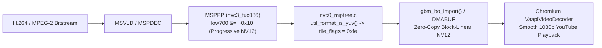

Over the past few months, our graphics stack work for legacy pre-Nova NVIDIA GPUs has expanded well beyond the Linux kernel. While **[`nouveau-dkms`](https://github.com/Twilight0/nouveau-dkms)** and **[`nouveau-utils`](https://github.com/Twilight0/nouveau-utils)** solved the kernel-side performance cliff — unlocking full core, shader, voltage, and zero-stutter VBlank DDR3 memory reclocking — unlocking the hardware's clocks quickly exposed the other half of the bottleneck: **userspace Mesa**.

For years, upstream Mesa's `nvc0` Gallium driver and VP4 video decode stack have been effectively in maintenance mode for Fermi (`GF100`–`GF119`) hardware. Kernel crashes on video teardown, broken VA-API buffer exports in modern browsers, missing OpenGL 4.6 / GLSL 460 enablement, and complete absence of Vulkan support left legacy NVIDIA GPUs feeling far older than their silicon actually is.

Today, we are sharing a major milestone across the entire AliveOS userspace graphics stack:
1. **The Launch of [`mesa-aliveos`](https://github.com/Twilight0/mesa-aliveos)** — our dedicated, CachyOS-style patched Mesa `26.3.1` distribution package, now live on GitHub, the AUR, and `aliveos-repo`.
2. **Zero-Copy Chromium `VaapiVideoDecoder` & Direct Progressive `NV12` (`26.3.1-2`)** — a firmware-level breakthrough in `MSPPP` (`nvc3_fuc086`) and `nvc0` DMABUF modifier handling that delivers buttery-smooth hardware-accelerated YouTube playback in Chrome/Chromium on Fermi.
3. **Our Userspace Mesa Roadmap** — the concrete rendering, compiler, Wayland, and OpenCL improvements queued next.
4. **Vulkan on Fermi (`vulkan-nouveau-aliveos` / `nvk-fermi`)** — why bringing up `NVK` on Fermi is far closer to reality than most people assume, what already exists in upstream Mesa's `NAK` compiler, and our newly scaffolded 3-milestone roadmap.

---

## 1. From `mesa-nouveau` to `mesa-aliveos`

What started as a local development tree (`mesa-nouveau`) for fixing VP4 video decode bugs and `nvc0` Gallium issues has now graduated into a clean, reproducible, standalone project: **[`Twilight0/mesa-aliveos`](https://github.com/Twilight0/mesa-aliveos)**.

Rather than maintaining a heavy, hard-to-rebase full fork of Mesa's multi-gigabyte Git history, `mesa-aliveos` follows the Arch Linux / CachyOS packaging model:
- It builds directly against the official **Mesa `26.3.1`** release tarball.
- It carries Arch Linux `extra/mesa 1:26.3.1-2` base patches (`0001`–`0002`) for full distro compatibility, layered cleanly with our numbered AliveOS patchset (`0003`–`0006`).
- It compiles universal `x86_64` Gallium and VA-API drivers (`-Dvideo-codecs=all`), acting as a drop-in replacement for Arch's `mesa` package while coexisting cleanly with standard `vulkan-*` and `opencl-mesa` packages.
- It ships automated GitHub Actions builds, an **[AUR package (`mesa-aliveos`)](https://aur.archlinux.org/packages/mesa-aliveos)**, and prebuilt binaries in **[`aliveos-repo`](https://github.com/Twilight0/aliveos-repo)**.

### What Shipped in `26.3.1-1` (Foundation)
Our initial `26.3.1-1` release consolidated months of stability and correctness fixes for `nvc0` and VP4 hardware video decoding:
- **VP4 Channel-Before-Engine Teardown**: Fixed `nouveau_vp3_decoder_destroy()`, `firmware_present()`, and `nvc0_screen_destroy()` so hardware video channels are cleanly torn down before engine objects, eliminating kernel `nouveau` faults and hangs on decoder exit.
- **Proper Fence & Pushbuf Isolation**: Added `out_fence`, `fence_wait`, and `destroy_fence` support along with isolated decoder pushbuf callbacks so multi-stream and rapid seek workloads stay synchronized.
- **Bounds & Sizing Clamps**: Fixed `nvc0_m2mf_transfer_rect()` out-of-bounds transfers, VA-API interlaced surface sizing/upload clamps, and H.264 `max_references` calculation.
- **VL Compositor Fixes**: Corrected `yuv420p` plane ordering and V-plane shader sampling in the video compositor.
- **OpenGL 4.6 / GLSL 460 & Compiler Stability**: Enabled GLSL `460` / OpenGL `4.6` on `nvc0` and raised the `nv50_ir` register allocator spill retry limit from `3` to `8` to prevent complex shaders from failing compilation.

---

## 2. The Breakthrough: Chromium `VaapiVideoDecoder` & Direct Progressive `NV12` (`26.3.1-2`)

Even with `mpv` and `ffmpeg` decoding cleanly over VA-API, modern Chromium-based browsers (Chrome, Vivaldi, Brave, Electron apps) remained stubbornly stuck on software decoding on Nouveau Fermi.

Digging into Chromium's `VaapiVideoDecoder` pipeline revealed **two separate blockers**:

1. **Field-Split `NV12` Output from VP4/MSPPP**: Upstream Nouveau's VP3/VP4 video decoder (`nouveau_vp3_video_msppp.c`) always programmed the `MSPPP` (Post-Processing Engine) microcode to output **field-split** `NV12` into two separate surfaces (top field and bottom field). Chromium expects a standard progressive `PIPE_TEXTURE_2D` `NV12` DMABUF surface.
2. **Missing YUV Tiling Metadata in `nvc0` GBM/DMABUF Export**: When Chromium imported the exported `DRM_FORMAT_NV12` DMABUF via `gbm_bo_import()`, `nvc0_choose_tiled_storage_type()` in `nvc0_miptree.c` did not handle `util_format_is_yuv()` formats, rejecting block-linear `NV12` buffers outright.

### Disassembling `nvc3_fuc086` (`MSPPP`)
We initially built a working fallback prototype (Branch A) that allocated a progressive `NV12` surface and ran a VPP copy pass on export. It worked smoothly, but it cost an extra VRAM allocation and a full-frame GPU copy on every decoded frame.

Before settling for a copy pass, we disassembled the actual Fermi `MSPPP` Falcon microcode (`/lib/firmware/nouveau/nvc3_fuc086`) using `envydis -m fuc -V fuc3 -i`. Inside the microcode's command setup, we found the exact control bit we were looking for:

- Bit `0x10` in the `low700` parameter (`0x1413` vs `0x1403`) is a **direct hardware toggle** between field-split output and **progressive `NV12` output**.

By clearing bit `0x10` (`low700 &= ~0x10`) whenever the target VA surface is a progressive `PIPE_TEXTURE_2D` `NV12` buffer, `MSPPP` writes a clean, contiguous progressive `NV12` frame straight into the target buffer — **zero VPP pass, zero extra VRAM, and zero copy bandwidth overhead**.

Paired with adding `util_format_is_yuv(format)` (`tile_flags = 0xfe`) to `nvc0_choose_tiled_storage_type()` in `nvc0_miptree.c`, the entire pipeline snapped into place in patch **`0006-nouveau-nvc0-progressive-nv12-msppp-and-yuv-modifiers.patch`** (shipped in **`mesa-aliveos 26.3.1-2`**).

### Verification Results
We did not stop at "it looks good" — we validated the direct progressive `MSPPP` path rigorously against software decoding:
- **Bit-Exact H.264 Verification**: Byte-for-byte identical `YUV420p` output compared against `ffmpeg` software decode across `64x64`, `640x360`, `854x480`, `1280x720`, `1920x1080`, and `720x480` interlaced H.264 streams.
- **MPEG-2 Verification**: `52.69 dB` PSNR on `1280x720` MPEG-2 decode.
- **Stress Testing**: 15x rapid decoder creation/teardown loops with zero `nouveau` kernel errors, zero hangs, and zero leaks.
- **Real-World Browser Test**: Live YouTube 1080p H.264 playback in `google-chrome-stable` running `VaapiVideoDecoder` — completely smooth, tear-free playback with minimal CPU load.

---

## 3. Future Plans for `mesa-aliveos`

With `mesa-aliveos` now cleanly packaged and automated, we have migrated all userspace graphics tasks out of `nouveau-dkms` into [`mesa-aliveos/TODO.md`](https://github.com/Twilight0/mesa-aliveos/blob/main/TODO.md). High-value items on our near-term roadmap include:

- **Dolphin Emulator `gl_FragCoord.z` Fix (PR #14993)**: Addressing depth-precision / `gl_FragCoord.z` shader edge cases affecting Dolphin on `nvc0`.
- **Fermi SSBO 64-Bit Bounds Clamping**: Tightening shader storage buffer object bounds handling on `GF100`–`GF119` to prevent out-of-bounds GPU faults in modern OpenGL compute and rendering workloads.
- **Wayland EGL Stability**: Improving Wayland EGL visual fallback behavior and defaulting `mesa_glthread=false` on `nvc0` where multithreaded GL dispatch currently hurts stability.
- **`nv50_ir` Compiler Optimizations**: Exploring dual-issue instruction scheduling and constant rematerialization to squeeze additional real-world FPS out of Fermi's scalar ALUs.
- **Z-Cull & Color Tile Compression (`TAGRAM`)**: Investigating hardware depth/color compression paths to save precious DDR3 memory bandwidth.
- **Rusticl OpenCL Allocation Cap**: Expanding `CL_DEVICE_MAX_MEM_ALLOC_SIZE` from the conservative 25% default toward ~90% of VRAM so OpenCL compute workloads can actually use available GPU memory.
- **Hybrid Compute / `MSENC` VA-API H.264 Encoding**: Investigating hardware-assisted H.264 encoding paths for screen recording and streaming.

---

## 4. The Next Frontier: Vulkan on Fermi (`vulkan-nouveau-aliveos` / `nvk-fermi`)

The question everyone with a Fermi GPU asks sooner or later is: **can Fermi run Vulkan?**

Historically, the answer has been "no" — NVIDIA dropped proprietary driver support at `390.xx` (before modern Vulkan extensions), and upstream Mesa's `NVK` driver starts at Kepler (`SM30` / `0xa097`) for experimental support and Turing+ for conformant support.

When we actually audited upstream Mesa `26.3.1` and our `nouveau-dkms` kernel stack, however, we discovered something remarkable: **most of the hardest infrastructure for Fermi Vulkan already exists.**

### What Already Exists Upstream
1. **`NAK` Already Has a 3,155-Line `sm20.rs` Backend**: Mesa's Rust-based NVIDIA shader compiler (`src/nouveau/compiler/nak/sm20.rs`) implements `ShaderModel20`, which covers both Fermi (`SM20`/`SM21`) and Kepler (`SM30`). Even better: `OpTex::encode()` in `sm20.rs` **already implements Fermi's bound texture reference encoding (`TexRef::Bound(idx)`)**. It is currently gated at `assert!(sm.sm >= 30)` solely because Collabora brought up Kepler first!
2. **`NVK` Already Runs on Kepler (`0xa097`)**: Fermi's 3D class (`FERMI_A` / `FERMI_C`, `0x9097`–`0x9297`) shares roughly 85%+ of its command stream, state methods, and descriptor layout with Kepler's `0xa097`.
3. **`nouveau-dkms` Already Speaks Modern `VM_BIND`**: Our kernel driver already exposes the modern `DRM_NOUVEAU_VM_BIND` and `DRM_NOUVEAU_EXEC` syncobj uAPI that `NVK` requires.

### What Remains to Bridge the Gap
Fermi is not identical to Kepler, and four specific hardware differences need to be addressed cleanly:
1. **Hardware Scoreboarded Instruction Emission (`sm < 30`)**: Kepler (`SM30`) introduced software-scheduled `sched` control words every 7 instructions. Fermi (`SM20`/`SM21`) uses a **hardware scoreboard** and does not use Kepler `sched` words. `NAK`'s `sm20.rs` needs an `sm < 30` emission path that omits Kepler scheduling packets and emits native Fermi instruction pairs.
2. **Bound Descriptor Lowering (`hasvk`-Style)**: Fermi predates bindless textures. Its hardware binding tables have **128 `TIC` (texture image), 32 `TSC` (sampler), and 8 `SU` (storage image)** bound slots per stage. We can lower Vulkan descriptor sets to bound `TIC`/`TSC` indices using the exact same proven NIR lowering strategy Intel's `hasvk` driver uses for Ivy Bridge / Haswell.
3. **`FERMI_COMPUTE_A` (`0x90c0`) Dispatch**: Wiring up Fermi's compute class for `vkCmdDispatch` and image-copy/clear meta shaders.
4. **Honest Vulkan 1.0 / 1.1 Feature Gating**: Exposing a clean, accurate Vulkan 1.0/1.1 feature profile matching Fermi's silicon capabilities (without pretending to have bindless or modern descriptor indexing).

### Introducing `vulkan-nouveau-aliveos`
To keep our Vulkan bring-up cleanly separated from the stable Gallium/VA-API `mesa-aliveos` package, we have scaffolded a dedicated sister project: **`vulkan-nouveau-aliveos`** (an NVK-only Mesa `26.3.1` package that builds `libvulkan_nouveau.so` cleanly alongside `mesa-aliveos`).

Our roadmap is broken into three clear milestones:
- **Milestone 1 — Bring-Up**: Lift the `sm >= 30` gate in `NVK` and `NAK`, implement Fermi `sm < 30` shader emission without Kepler `sched` words, and get `vulkaninfo` and **`vkcube`** rendering cleanly on Fermi hardware.
- **Milestone 2 — Real Applications**: Implement `hasvk`-style bound `TIC`/`TSC` texture lowering and `FERMI_COMPUTE_A` (`0x90c0`) compute dispatch to bring up **`mpv --gpu-api=vulkan`**, **RetroArch**, **PPSSPP**, and **Dolphin Vulkan**.
- **Milestone 3 — Ecosystem & Compatibility**: Work through targeted Vulkan CTS subsets, **DXVK 1.10.3** (the last DXVK branch targeting Vulkan 1.1), and **Zink** validation.

---

## Try It Today & Follow the Progress

If you are running Arch Linux, CachyOS, or AliveOS on a legacy NVIDIA GPU:
- **Userspace Mesa (`26.3.1-2`)**: Install `mesa-aliveos` from the **[AUR](https://aur.archlinux.org/packages/mesa-aliveos)**, **[GitHub Releases](https://github.com/Twilight0/mesa-aliveos/releases)**, or **[`aliveos-repo`](https://github.com/Twilight0/aliveos-repo)**.
- **Kernel Driver & Governor**: Pair it with **[`nouveau-dkms`](https://github.com/Twilight0/nouveau-dkms)** and **[`nouveau-utils`](https://github.com/Twilight0/nouveau-utils)** for full reclocking and hardware telemetry.
- **Community Discussion**: Follow live testing reports, hardware benchmarks, and Vulkan bring-up discussions in **[GitHub Discussions #45](https://github.com/Twilight0/nouveau-dkms/discussions/45)**.

15-year-old silicon still has plenty of life left in it — we are just getting started.
